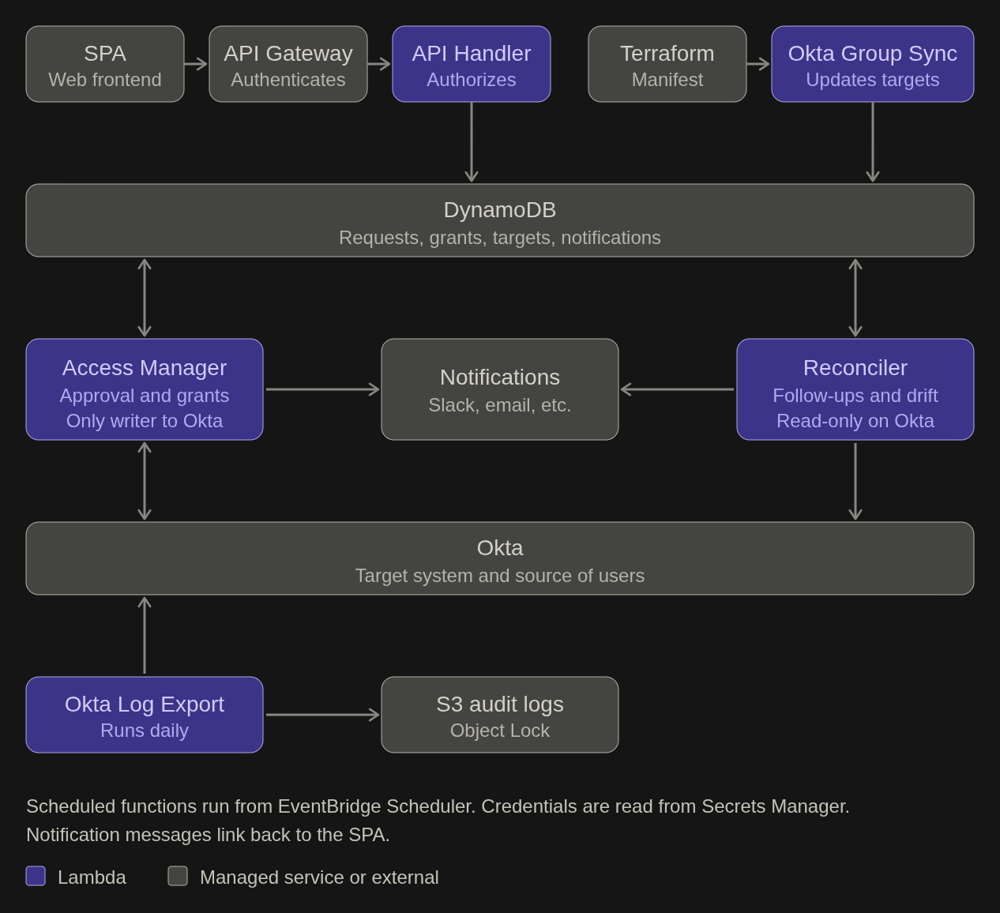
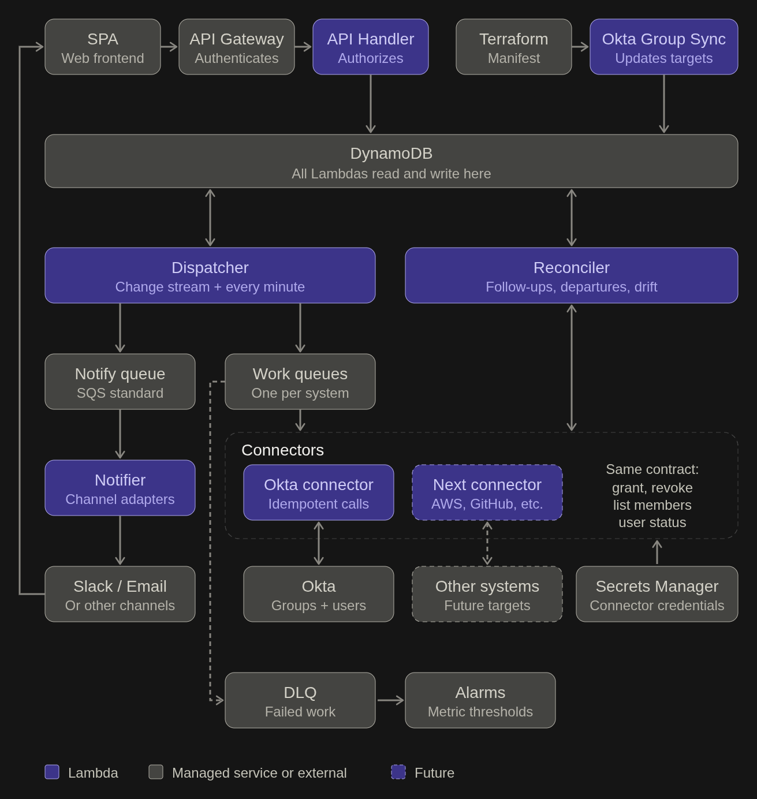

# Design

## Definitions

|          Term          |                                         Definition                                          |
|------------------------|---------------------------------------------------------------------------------------------|
| Access Target (Target) | Something to grant access to, like an `Okta` group or an `AWS` Role                         |
| Target System (System) | The system on which the target is hosted, like `Okta` or `AWS`                              |
| Target Owner (Owner)   | Users who can approve access requests for the target                                        |
| Approvers              | The owners of the target, or the members of the IAM team for targets with a special process |
| Connector              | The code that talks to a Target System (adding/removing users, reading memberships)         |
| IAM Team               | The team that manages and maintains this application                                        |
| IAM Engineer Team      | The team that maintains the `Okta` group definitions in Terraform                           |
| Incomplete Request     | An access request that is still "Pending", "Pending Approval" or "Approved"                 |

\*The `Access Manager` and the `Reconciler` share the connector code. Only the `Okta` connector is described here.

## Diagram

## Components

The design is made of a web frontend, an API, three `Lambda` functions for the business logic, a database and a few
supporting components. The application runs on `AWS`, and the scheduled functions are triggered by
`EventBridge Scheduler`.

### SPA Frontend

A single page application (SPA) exposes the application's features to users. It is a thin frontend over the API.
Everything it displays or triggers goes through the `API Gateway`, so no business logic lives in the browser.

### API Gateway

The `API Gateway` is the entry point for all SPA calls. It authenticates every call (using the company's identity
provider) and forwards it, along with the caller's identity, to the `API Requests Handler`.

End users can:

- List their access requests
- List their access grants
- List the targets they can request access to
- Request access to a target
- Cancel their incomplete access requests
- Revoke their own access to a target (self-revocation)

Target owners can also:

- Request access on behalf of another user for targets they own
- List access requests made on behalf of other users
- Cancel incomplete access requests made on behalf of other users
- List access requests awaiting approval for targets they own
- Approve or deny an access request for targets they own
- List access grants for targets they own
- Revoke an access grant for targets they own

### Lambda Functions

The business logic is handled by three `Lambda` functions. The `Access Manager` handles the happy path and is the only
one writing to target systems. The `Reconciler` only reads from them and handles everything that needs a follow-up
(reminders, stale requests, departures, drift).

All `Lambda` functions are written in Python, using `boto3` for `AWS`, the `Okta` Python SDK for `Okta` and
`AWS Lambda Powertools` for structured logging (see Audit).

#### `API Requests Handler`

Runs behind the `API Gateway`.

- Authorizes the caller, based on the identity provided by the `API Gateway`
- Validates and performs the API request
- Updates the database when required

#### `Access Manager`

Runs on a schedule (limited to 1 concurrent run).

- Reads pending work from the database
- Routes new access requests (automatic approval, or notification of the approvers)
- Creates grants for approved requests
- Finds pending actions (grants and revocations) and executes them by adding/removing users from the targets
- Updates the database when required
- Sends notifications to approvers when a request needs approval, and to the user receiving the access when it is
  approved, denied, granted or revoked

#### `Reconciler`

Runs on a schedule (limited to 1 concurrent run).

- Reads from the database and from the target systems
- Compares the access granted in the database with the actual access on the target systems
- Sends the drift report to the IAM team
- Finds stale requests and cancels them (incomplete requests of a departed employee, etc.)
- Ends the grants of departed users and removed targets (see Lifecycle)
- Sends reminders for requests awaiting approval (including when the approvers changed)
- Checks the status of access target owners and notifies the IAM team when owners need updating
- Finds aging requests and notifies the IAM team

### Database

A `DynamoDB` database is shared by all `Lambda` functions. It holds:

- Access requests
- Access grants
- Access targets
- Notifications sent

The `Okta` group definitions (Access Targets) are maintained by the IAM Engineer team in Terraform. There are several
ways to make them available to the application:

- Access to a data source the IAM Engineer team already maintains
- A wrapper over their Terraform `Okta` module that passes calls through to `Okta` and keeps our own data source up to
  date
- A versioned manifest produced by their Terraform, which we use to keep our own data source up to date automatically

I lean toward the manifest. It is less intrusive for the IAM Engineer team than the Terraform wrapper, and it gives us
more control over the data than accessing their data source directly. In any case, a sync meeting should be held with
their team to agree on an approach that suits both teams. The `Okta Group Sync` supporting component implements the
chosen approach.

### Supporting Components

A few other components support the design:

- `Okta Group Sync` runs on a schedule, reads the manifest produced by the IAM Engineer team's Terraform and keeps the
  `Okta` group access targets up to date. It creates a new version when a group changes, closes the current version when
  a group is removed from the manifest, and rejects a malformed manifest instead of applying part of it. It only touches
  the targets it manages. Any failure is reported to the IAM team, since the rest of the application would keep acting
  on outdated targets (owners, authorized requesters). Other target systems get their own sync, adapted to their source
  of truth.
- `Okta Log Export` runs on a schedule and copies the `Okta` system logs to the audit storage (see Audit). Any failure
  is reported to the IAM team.
- `Secrets Manager` holds the `Okta` API credentials: a write credential for the `Access Manager`, and a read-only
  credential for the `Reconciler` and the `Okta Log Export`
- `CloudWatch Logs` collect the application logs, which are archived in `S3` with Object Lock (see Audit)

---

## Data Models

### Database

#### Access Request

|    Field     |                                        Details                                        |
|--------------|---------------------------------------------------------------------------------------|
| Id           | ID of the access request                                                              |
| User Id      | ID of the user for whom the access is requested                                       |
| Target Id    | ID of the access target for which the access is requested                             |
| Requested By | ID of the user who made the request                                                   |
| Requested On | Date the request was made                                                             |
| Reason       | Why the user needs this access                                                        |
| Status       | Status of the request (Pending/Pending Approval/Approved/Denied/Cancelled/Completed)  |
| Starts On    | Date at which the access should be activated (NULL = ASAP)                            |
| Ends On      | Date at which the access should be revoked (NULL = Indefinitely)                      |
| Approved By  | ID of the user who approved or denied the request ("System" = Approved automatically) |
| Approved On  | Date on which the request was approved/denied                                         |

\*A "Completed" request means its grant has been created, not that the user has access. The grant's status tracks that.

\*Indexed by status and date (to find the requests to process), by user and target (a user's requests and the duplicate
check), by target and status (an owner's requests awaiting approval) and by requester (requests made on behalf of others).

#### Access Grant

|   Field    |                                  Details                                   |
|------------|----------------------------------------------------------------------------|
| Id         | ID of the access grant                                                     |
| Request Id | ID of the access request                                                   |
| User Id    | ID of the user for whom the access is granted                              |
| Target Id  | ID of the access target for which the access is granted                    |
| Status     | Status of the grant (Pending/Active/Revoked/Failed)                        |
| Granted On | Date at which the access was activated                                     |
| Ends On    | Date at which the access should be revoked (NULL = Until manually revoked) |
| Revoked By | ID of the user that revoked the access ("System" = Revoked automatically)  |
| Revoked On | Date at which the access was revoked                                       |

\*Indexed by status and end date (to find the grants to provision or revoke), by user and target (a user's grants and
the duplicate check) and by target and "Granted On" (the audit question and an owner's grants). The last index also
includes "Revoked On", "Revoked By", "User Id" and "Request Id", so the audit question is answered from the index alone.

#### Access Target

|        Field          |                                    Details                                     |
|-----------------------|--------------------------------------------------------------------------------|
| Id                    | ID of the access target (the same for all its versions)                        |
| Active From           | The date from which this version of the target was active                      |
| Active To             | The date until which this version was active (NULL = current version)          |
| System                | External system providing the access (`Okta`, `AWS`, etc.)                     |
| Name                  | Name of the target                                                             |
| Description           | Textual description of the access given by the target                          |
| Owners                | Owners/Approvers for this target                                               |
| Approval Method       | How requests for this target are approved (Auto/Owners/Special Process)        |
| Authorized Requesters | Who can request access to this target                                          |
| Maximum Duration      | For how long this access can be requested                                      |
| System Metadata       | Data only the connector of this system reads (`Okta` group ID, `AWS` role ARN) |

\*Each change to a target creates a new version. The table is keyed by "Id" (partition key) and "Active From" (sort
key), and the current version is the one with no "Active To". The resource a target points to never changes between its
versions: a different group or role is a different target. A sparse index by system only contains the current versions,
which lists the requestable targets and lets each sync compare the manifest with the targets it manages.

#### Notification

|   Field    |                                Details                                 |
|------------|------------------------------------------------------------------------|
| Id         | ID of the notification                                                 |
| Request Id | ID of the related access request                                       |
| User Id    | ID of the user being notified                                          |
| Sent On    | Date the notification was sent                                         |
| Type       | The type of notification sent (Approval request, granted access, etc.) |

\*Indexed by request, to find when and to whom a request was last notified.

### API

#### List access requests for user (GET)

|       Field       |                                       Details                                        |
|-------------------|--------------------------------------------------------------------------------------|
| Access Request Id | ID of the access request                                                             |
| Target Name       | Name of the target for which the access is requested                                 |
| Requested By      | Who made the request                                                                 |
| Requested On      | Date the request was made                                                            |
| Reason            | Why the user needs this access                                                       |
| Status            | Status of the request (Pending/Pending Approval/Approved/Denied/Cancelled/Completed) |
| Starts On         | Date at which the access should be activated (NULL = ASAP)                           |
| Ends On           | Date at which the access should be revoked (NULL = Indefinitely)                     |

#### List access grants for user (GET)

|      Field      |                                  Details                                   |
|-----------------|----------------------------------------------------------------------------|
| Access Grant Id | ID of the access grant                                                     |
| Request Id      | ID of the access request                                                   |
| Target Name     | Name of the target for which the access is granted                         |
| Status          | Status of the grant (Pending/Active/Revoked/Failed)                        |
| Granted On      | Date at which the access was activated                                     |
| Ends On         | Date at which the access should be revoked (NULL = Until manually revoked) |
| Revoked On      | Date at which the access was revoked                                       |

#### List requestable access for user (GET)

|       Field        |                        Details                        |
|--------------------|-------------------------------------------------------|
| Target Id          | ID of the target                                      |
| Target Name        | Name of the target                                    |
| Target Description | Textual description of the access given by the target |
| Requires Approval  | If a request to that target requires approval         |
| Maximum Duration   | For how long this access can be requested             |

#### Access request (POST, from users or target owners)

|   Field   |                                      Details                                      |
|-----------|-----------------------------------------------------------------------------------|
| User Id   | ID of the user for whom the access is requested                                   |
| Target Id | ID of the target for which the access is requested                                |
| Reason    | Why the user needs this access                                                    |
| Starts On | Date at which the access should be activated (NULL = ASAP)                        |
| Ends On   | Date at which the access should be revoked (NULL = Maximum duration/Indefinitely) |

#### Access request cancellation (POST, from users or requesters)

|       Field       |                            Details                            |
|-------------------|---------------------------------------------------------------|
| Access Request Id | ID of the access request to cancel (before it is "Completed") |

#### Access revocation (POST, from users or target owners)

|      Field      |                         Details                         |
|-----------------|---------------------------------------------------------|
| Access Grant Id | ID of the access grant to revoke                        |
| Ends On         | Date at which the access should be revoked (NULL = Now) |

#### List access requests made on behalf of other users (GET)

|       Field       |                                       Details                                        |
|-------------------|--------------------------------------------------------------------------------------|
| Access Request Id | ID of the access request                                                             |
| User Name         | Whom the request was made on behalf of                                               |
| Target Name       | Name of the target for which the access is requested                                 |
| Requested On      | Date the request was made                                                            |
| Reason            | Why the user needs this access                                                       |
| Status            | Status of the request (Pending/Pending Approval/Approved/Denied/Cancelled/Completed) |
| Starts On         | Date at which the access should be activated (NULL = ASAP)                           |
| Ends On           | Date at which the access should be revoked (NULL = Indefinitely)                     |

#### List access requests on owned targets awaiting approval (GET)

|       Field       |                       Details                        |
|-------------------|------------------------------------------------------|
| Access Request Id | ID of the access request to approve                  |
| Target Name       | Name of the target for which the access is requested |
| User Name         | Name of the user for whom the access is requested    |
| Reason            | Why the user needs this access                       |
| Starts On         | Date at which the access should be activated         |
| Ends On           | Date at which the access should be revoked           |

#### Approve/Deny an access request (POST)

|       Field       |                      Details                      |
|-------------------|---------------------------------------------------|
| Access Request Id | ID of the access request to approve/deny          |
| Approved          | True if access is approved, false if it is denied |

#### List access grants on owned targets (GET)

|      Field      |                                  Details                                   |
|-----------------|----------------------------------------------------------------------------|
| Access Grant Id | ID of the access grant                                                     |
| Target Name     | Name of the target for which the access is granted                         |
| User Name       | Name of the user for whom the access is granted                            |
| Status          | Status of the grant (Pending/Active/Revoked/Failed)                        |
| Granted On      | Date at which the access was activated                                     |
| Ends On         | Date at which the access should be revoked (NULL = Until manually revoked) |
| Reason          | Why the user needs this access (from the request)                          |
| Approved By     | Who approved the request (from the request)                                |

---

## Approval Workflow

Approvals are driven by the `Access Manager` (routing and first notification), the `API Requests Handler` (decisions)
and the `Reconciler` (reminders and escalations). A request moves through the following statuses: **Pending** →
**Pending Approval** → **Approved** (or **Denied**), and is **Completed** once its grant has been created (see
Provisioning). A request that is not completed yet can be **Cancelled**.

### Routing and notification

When the `Access Manager` finds a "Pending" access request, it applies the first of these rules that matches:

- **Special process:** the request is set to "Pending Approval" and the IAM team is notified like for any request
  that needs approval. It is never approved automatically, since the approval itself depends on a process that takes
  place outside the application (see Open questions).
- **Automatic approval:** the request is set to "Approved" right away, with "Approved By" set to "System" and
  "Approved On" set to the current date/time, whoever made the request.
- **Requested by an owner for another user:** the request is set to "Approved" right away, with "Approved By" set to
  the requesting owner and "Approved On" set to the current date/time.
- **Approval required:** the request is set to "Pending Approval" and a notification (Slack/Email/etc.) is sent to the
  approver(s) with all relevant information and a direct link to the request. The notification is recorded in the
  database.

### Reminders

For each "Pending Approval" request, the `Reconciler` checks whether the approvers changed since the last
notification, or whether a reminder is due. If so, it notifies the approver(s) again. The `Reconciler` runs once a day,
at the beginning of the day, so reminders are sent in batch (one notification listing all pending approvals on the
targets an owner manages), which avoids flooding target owners.

### Decision

Approvers approve or deny requests from the SPA. Any single owner of the target can decide. When a decision is
submitted, the `API Requests Handler` validates that:

- the user is an approver of the request
- the user is not the one receiving the access
- the request is still "Pending Approval"
- the requested period has not already ended

The status update is a conditional write on the request's current status, so two owners deciding at the same time cannot
both succeed. "Approved By" and "Approved On" are then set, the status becomes "Approved" or "Denied". For approved
requests, the next `Access Manager` run creates the grant, completes the request and notify the user, then it provisions
the access (see Provisioning).

### Edge cases

- **Approver not responding:** reminders continue as described above. When a request has been "Pending Approval" longer
  than a configured threshold (for example 5 business days), the `Reconciler` also notifies the IAM team with the
  list of aging requests. Escalations are recorded as notifications, so they are not repeated on every run. The
  requester can follow the request status in the SPA and can cancel it as long as it is not "Completed".
- **Owner unavailable:** all owners are notified and any one of them can approve, so a single absence does not block a
  request. If every owner is unavailable, the escalation above applies and the IAM team asks for the owners to be
  updated (for `Okta` groups, the IAM Engineer team, through Terraform). The `Reconciler` detects the change and
  notifies the new owners on its next run.
- **Owner leaving the company:** the `Reconciler` checks the status of the owners listed in the access targets. A
  departed owner is no longer notified and the IAM team is told that the target's owners need updating. Pending requests
  stay in "Pending Approval" and follow the path above. If no active owner remains, the IAM team is notified immediately
  instead of waiting for the threshold.
- **Requester leaving the company:** the `Reconciler` cancels their incomplete requests.

### Open questions

**Who approves access for the only owner of a target?** An owner cannot approve access for themselves, so another
owner has to approve it. A target with a single owner would block that owner. I lean toward listing the IAM team (or
another group) as an additional owner of such targets, which is only configuration in the target definition. The
alternative is to require at least two owners on every target, which is safer but harder to maintain.

**Where does IT Helpdesk fit?** Some groups can be granted by IT Helpdesk without further approval. I assumed IT
Helpdesk is listed as an owner of these targets: a Helpdesk member's request on behalf of a user is then approved right
away, while a request made by the users themselves waits for a Helpdesk member to approve it. If these groups should
instead be requestable by anyone without approval, they would use the automatic approval method. To be confirmed with
the IAM team.

**How are requests for targets with a special process approved?** Some targets cannot be approved by their owners
alone: the approval is an external process (a separate review, for example) that the application does not control.
These targets can still be requested from the application, but there is no single approver, and I am not sure yet how
best to represent that. I lean toward making the IAM team the approvers of these requests by rule, whatever the owners
of the target are. The request waits in "Pending Approval", the IAM team is notified that an external process has to
take place, and a member of the team approves or denies the request in the application once the process is complete.
This reuses the existing flow without adding a new concept. The drawbacks are that the approval recorded in the
application is the IAM team member's, not that of the people who actually approved (the evidence is in the external
process, so a reference to it should be stored), and that the IAM team becomes a manual bridge. The alternatives are a
dedicated status for requests waiting on an external process, or a link to a ticket in an external system.

## Provisioning

\*This provisioning flow is specific to `Okta` groups and will change for other target systems.

Only the `Access Manager` provisions and de-provisions access. Each run goes through the steps below, in this order.

### Creating grants

The `Access Manager` finds "Approved" access requests whose "Starts On" date has been reached (or is NULL). For each
one, it creates a grant with the "Pending" status and the request's "Ends On" date, and sets the request's status to
"Completed". Both changes are made in a single database transaction, conditional on the request still being
"Approved", so a request never ends up with a grant while still "Approved" and never gets a second grant.

A "Completed" request only means that its grant has been created. Whether the user actually has access is tracked by
the grant's status.

### Granting access

The `Access Manager` finds "Pending" grants and adds the user to the `Okta` group using the `Okta` API. If it
succeeds, the grant's status is set to "Active" and "Granted On" is set to the current date/time. A "Pending" grant
whose "Ends On" date has already been reached (because it was revoked before being provisioned, or provisioning was
delayed) is not provisioned and is set to "Failed", since the access was never granted.

### Revoking access

The `Access Manager` finds "Active" grants whose "Ends On" date has been reached and removes the user from the `Okta`
group using the `Okta` API. This covers grants that reached their end date, as well as manual revocations (which set
"Ends On" to now, and "Revoked By" to the user who revoked it). If it succeeds, the grant's status is set to "Revoked"
and "Revoked On" is set to the current date/time. When a grant reaches its end date on its own, "Revoked By" is set to
"System".

### Errors and retries

Every call to the `Okta` API is logged, whether it succeeds or fails. When a call fails, the `Access Manager` decides
what to do based on the type of error:

- **Temporary errors** (rate limiting, server errors, timeouts, credential problems, etc.): the grant keeps its
  current status and is retried by the next `Access Manager` run.
- **Permanent errors** (the group or the user no longer exists, etc.): a grant that cannot be provisioned is set to
  "Failed" and is not retried until a maintainer fixes the cause and sets it back to "Pending". When revoking, a
  missing group or user means the access is already gone, so the grant is set to "Revoked".

At the end of each run, a single notification listing all the errors encountered is sent to the IAM team. Failed
revocations deserve the most attention, since the user keeps an access they should no longer have.

### Recovery

The design makes sure a crash or timeout at any point leaves the application in a state the next run can recover from:

- The grant is created before calling `Okta` (in the same transaction that completes the request), so an interrupted
  run leaves a "Pending" grant that is picked up again.
- If a call succeeded but the database update was lost, the retry finds the user already in the group and simply marks
  the grant as "Active" (or "Revoked" when the user is already gone).
- Status updates are conditional writes on the current status, so a request or a grant cannot be processed twice.
- Only one `Access Manager` run can be active at a time, and each run stops before the `Lambda` time limit. Whatever is
  left is processed by the next run.

## Audit

The access requests and grants (database) should be sufficient to determine who had access to what at any specific
moment and who approved it:

- The grants of a target X that were active at a moment Y are those with "Target Id" X, "Granted On" on or before Y,
  and "Revoked On" empty or after Y.
- The request of each grant shows who requested the access ("Requested By"), who approved it ("Approved By") and when.
- The version of the access target that was active at the approval date shows who the owners were, so it is possible to
  check that the approver was allowed to approve at that time.
- "Revoked By" on the grant shows who ended the access ("System" when it ended on its own).

However, bugs happen and information could be lost in the database. As a second layer of security, all actions
mutating an access request or grant, all API calls to target systems (`Okta`, etc.) and all authorization failures must
be logged in all cases (success or failure). Each log entry contains who did it, what was done, the request or grant
concerned, its previous and new status, and the date/time. This allows the team to reconstruct any event that would be
missing from the database. Logs are collected by `CloudWatch Logs` and archived in a tiered `S3` bucket with lifecycle
rules, which keeps them in long-term storage for as long as auditability requires. `S3` Object Lock prevents anyone from
modifying or deleting them before the end of the retention period, which is to be defined with the organization's audit
requirements.

As an additional measure, the `Okta Log Export` exports the `Okta` system logs to the same storage every day to cover
any operation that could have taken place outside of our application. `Okta` only keeps these logs for a limited time,
and each export covers the last few days, so one failed run does not leave a gap.

## Authentication and Authorization

### Authentication

Authentication is handled at the `API Gateway` level. This makes sure that, when a call reaches the
`API Requests Handler`, the user has been authenticated and the application knows who they are. The identity comes from
the `API Gateway`, not from the content of the request. The exact mechanism (for example validating tokens issued by the
company's identity provider) will be refined depending on what the company uses.

### Authorization

Authorization is handled by the `API Requests Handler` (the function behind the `API Gateway`). Before performing any
action, it checks the rules below against the current data: the current status of the request or grant, and the
current version of the access target. Rights therefore change as soon as the data does. For example, an owner removed
from a target can no longer approve requests on it. Each check is made against the specific request, grant or target
in the call, not only against the endpoint, so knowing an ID gives no access to it.

**Listing**

- A user can only list their own access requests and grants
- A user can only list as requestable the targets whose authorized requesters include them
- A target owner can only list the requests and grants of the targets they own, and the requests they made on behalf of
  others
- A member of the IAM team can also list the requests awaiting approval for targets with a special process

**Requesting**

- A user can request access for themselves to a target whose authorized requesters include them
- Only an owner of a target can request access to it on behalf of another user. Such a request is approved right away,
  except for targets with a special process (see Approval Workflow)
- A request is rejected when the user it is for already has an open request or a pending or active grant on the same
  target
- The requested period must respect the maximum duration of the target, and "Ends On" must be after "Starts On". When
  no "Ends On" date is given, the maximum duration applies

**Cancelling**

- A request can be cancelled by its requester or by the user it was made for, as long as it is not "Completed"

**Approving or denying**

- The caller is an approver of the request (see Definitions)
- The caller is not the user receiving the access
- The request is still "Pending Approval"
- The requested period has not already ended

**Revoking**

- A user can revoke their own grants, and an owner can revoke the grants of the targets they own
- A revocation can only bring the end date closer, it cannot move it later

### Service security

Users do not call the `Lambda` functions directly. The `API Requests Handler` can only be reached through the
`API Gateway`, and the other functions and jobs only run on their schedule. Each of them has its own IAM role, limited
to what it does:

- `API Requests Handler`: reads and writes access requests and grants, and reads access targets. It has no access to the
  `Okta` credentials since it does not call target systems.
- `Access Manager`: reads and writes access requests, grants and notification details, reads access targets, and can
  read the `Okta` write credential
- `Reconciler`: reads the data it compares, writes only what it is responsible for (cancelling stale requests, setting
  end dates, recording the notifications it sends), and can only read the `Okta` read-only credential
- `Okta Group Sync`: writes access targets only
- `Okta Log Export`: can read the `Okta` read-only credential and writes only to the audit storage

Credentials are stored in `Secrets Manager`, never in the code, the configuration or the logs, and each function can
only read the ones it needs. The `Okta` credential that can change group memberships is used by the `Access Manager`
only, with the narrowest permissions `Okta` supports (ideally limited to the groups managed by the application). The
other functions use a read-only credential. Scoped OAuth service credentials are preferred over long-lived API tokens,
if the company's `Okta` setup allows it. Credentials need a rotation process, and a compromised write credential is
the biggest risk of the application, since it can change the membership of the groups it manages.

The `Access Manager` and the `Reconciler` also read the credentials of the notification channels (Slack, email, etc.)
from `Secrets Manager`.

The owners and authorized requesters of the access targets drive all authorization decisions, so whoever can change
the manifest can make themselves an approver. The review process of the IAM Engineer team's Terraform is therefore part
of the security of this application, and only `Okta Group Sync` can write access targets.

## Lifecycle

People and targets come and go while requests and grants are in flight. `Okta` is the source of truth for users, and
the IAM Engineer team's Terraform for `Okta` group targets, so the application learns about these changes by looking at
them: the `Reconciler` checks the status of the users found in incomplete requests and in pending or active grants,
and `Okta Group Sync` applies the changes of the manifest. The `Reconciler` then acts on what it finds, but it never
changes a target system itself. It only updates the database, and the `Access Manager` performs the revocations like
any other. All of this happens on the `Reconciler`'s schedule (see the "Delays" limitation).

### User leaving the company

When a user is deactivated in `Okta`:

- Their incomplete requests (made by them or for them) are cancelled.
- Their pending and active grants get an "Ends On" date set to now. The `Access Manager` revokes them as usual, with
  "Revoked By" set to "System". A pending grant that was never provisioned is set to "Failed" (see Provisioning), and
  a missing user or group counts as already revoked (see Errors and retries).
- If they are the owner of a target, see the edge cases of the Approval Workflow.

Since the account is already deactivated, the delay before the revocation mostly affects the accuracy of the records.
A user who comes back has to request their accesses again.

### Target removed

When a target disappears from the manifest, `Okta Group Sync` closes its current version ("Active To") and does not
create a new one. A target without a current version cannot be requested, and its requests cannot be approved. The
`Reconciler` then cancels its incomplete requests and ends its pending and active grants the same way as for a
departed user. All the versions of the target and all its requests and grants are kept, so the history stays
auditable.

A mistake in the manifest is the most dangerous case, since removing a target ends all its grants. `Okta Group Sync`
therefore refuses to close more than a configured number of targets in one run, and reports it to the IAM team instead.

### Target changed

Other changes to a target (owners, maximum duration, etc.) create a new version and do not affect the existing grants
(see the "Access target changes" limitation).

## Time-bound Access

By design, the application handles time-bound access by setting an "Ends On" date on an access grant. The requester
chooses this date within the maximum duration of the target, which is checked when the request is made. When no date is
chosen, the maximum duration applies, or the access is indefinite if the target has no maximum duration. The date is
applied when the request is created, so the approver sees the resulting date. The date can also be set to "now" when the
access is revoked manually. When the date is reached, the `Access Manager` revokes the access like any other revocation
(see Provisioning), so no separate mechanism is needed.

Things that could go wrong:

- **Revocation is late:** the access lasts up to the schedule frequency of the `Access Manager` beyond its end date (see
  the "Delays" limitation).
- **Revocation fails:** the user keeps an access they should no longer have. The revocation is retried on every run
  and reported to the IAM team, which makes these failures the most important ones to monitor.
- **Revocations pile up:** after an outage, many revocations can be due at once. Each run processes as many as `Okta`
  accepts and the next run continues.
- **The end date is reached before the access is provisioned:** the grant is not provisioned and is set to "Failed",
  since the access was never granted.
- **The access is changed outside of the application:** a user re-added to a group by hand after the revocation is only
  found by the `Reconciler`'s drift report (see the "Exclusivity over `Okta` group memberships" limitation).
- **The maximum duration changes after approval:** existing grants keep their end date (see the "Access target changes"
  limitation).

Extensions, and a notification to the user before their access ends, are not handled (see "What was cut" in the "What's
Next" section).

## What's Next

### What was cut

The design focuses on the core flow (request, approval, provisioning, audit). To keep it so, the following was left out:

- Grant extensions, and a notification to the user before their access ends. A user who needs the access beyond its
  end date has to wait for the grant to be revoked and request it again, which leaves a gap in their access, and a user
  cannot make a new request while they have an open request or an active grant on the same target.
- Approvals that require several owners, delegation (owner on vacation) and emergency (break-glass) approval.
- Target systems other than `Okta` groups. The design is generic (targets, connectors, one sync per system), but only
  the `Okta` flow is described.
- Automatic resolution of drift, and a proper retry policy (see the limitations below).

### Next steps

#### `Okta Group Sync`

Meet with the IAM Engineer team and find the best way to sync the `Okta` group definitions between the two teams (see
Database). The resulting `Okta Group Sync` should be built with speed and resiliency in mind since the rest of the
application acting on incorrect access targets could lead to malfunctions or authorization failures.

#### Open questions

Settle the open questions of the Approval Workflow with the IAM team (sole owners, special process, IT Helpdesk).

### Risks and limitations

The main risks of going to production are a compromised `Okta` write credential, which can change the membership of
every group the application manages (see Service security), an incorrect manifest, since the targets drive every
authorization decision and removing one ends its grants (see Lifecycle), and revocations that fail or come late, which
leave users with an access they should no longer have (see Time-bound Access). The following limitations are factors
that should be fixed before going to production.

#### Delays

Since the `Access Manager` and the `Reconciler` are triggered by schedules, provisioning/de-provisioning can be
delayed by the `Access Manager`'s schedule frequency, including the revocation of time-bound access: a user keeps
their access up to that long after its end date. Reminders, escalations and the revocations caused by departures are
delayed further by the `Reconciler`'s schedule. This is even more important if errors are encountered (Rate limiting,
etc.), which could delay actions even more.

#### Retries are unbounded

Temporary errors are simply retried on every `Access Manager` run, with no backoff and no attempt limit, so a failure
that is wrongly seen as temporary keeps failing and notifying the IAM team until someone fixes its cause.

#### Exclusivity over `Okta` group memberships

This design assumes the application is the only one managing `Okta` group membership. If an external entity adds a user
to a group and the application receives an access request for the same user and the same target group, when the grant is
revoked later on, the user will lose their membership, even if they were already in the group before the access request.

#### Drift is handled manually

The `Reconciler` only generates a drift report and sends it to the IAM team. It does not resolve the drift
automatically, which could result in some lingering drift if the IAM team is not addressing it quickly.

#### Access target changes

Changes to an access target could present some edge cases like this:

- A user requests access to a target they are allowed to, access gets approved and granted, but then the target is
  updated and this same user is not allowed to request this access anymore. In this case, the user's access will stay
  intact.
- A user requests an indefinite access to a target that has no maximum duration, the access is granted, but then the
  target is updated and a maximum duration is added to the target. In this case, the user's access will persist until
  manually revoked.

#### Duplicate check is not strict

The check for an existing open request reads an index, so two simultaneous requests for the same user and target can
both pass it.

### Alternative Design

While working on this design, some limitations were making me uncomfortable and I ended up thinking of a different
design, event-based, that is a bit more complex to implement but would be more reliable, faster and more auditable. I
would move to it when delays or rate limits become a problem, when volume grows, or when a second target system is
added. I'm providing a diagram here so we can talk about it during the next interview.

